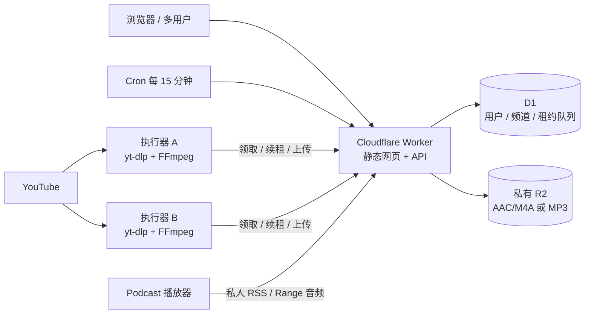

# YouTast

开源的自行部署应用。请使用自己的 Cloudflare 资源与执行器；本仓库不包含在线实例的账号或凭据。本机部署记录和验证产物不随仓库分发。

把 YouTube 视频转成私人 podcast 的可自行部署应用。Cloudflare 保存网页、账号、任务和音频；你自己的电脑或服务器负责下载、转码，并主动轮询任务。无需给执行器机器开放公网端口。

当前版本为 MVP：**原视频音轨 → AAC/M4A（保留旧MP3）→ 私人 RSS**，不包含 AI 摘要、配音或转写。

## 文档导航

| 文档 | 用途 |
| --- | --- |
| [开发与测试](docs/DEVELOPMENT.md) | 环境、目录、测试分层和本地数据边界 |
| [贡献规范](CONTRIBUTING.md) | 分支、提交、检查与评审 |
| [版本与发布](docs/RELEASING.md) | 版本号、迁移、发布记录和回退 |
| [变更记录](CHANGELOG.md) | 已发布基线与未发布功能 |
| [安全说明](SECURITY.md) | 私人链接、凭据和问题报告 |
| [开发交接](docs/HANDOFF.md) | 2026-10-23 的实现快照、历史验证和待办 |
| [执行器说明](executor/README.md) | 机器端安装、运行和可选 YouTube 会话 |

包版本仍为 `0.1.0`；后续功能记在 CHANGELOG 的“未发布”部分。Git 提交、应用版本、Cloudflare Version ID 和执行器协议是不同的标识，不能相互替代。

## 已实现

- 邀请口令注册、用户名和密码登录、多用户数据隔离、7 天登录会话。
- 每个用户可建立多个频道；一个频道可混合添加单视频、多条视频、playlist、作者主页。
- 频道的「来源」中可删除单个来源：停止后续扫描并取消扫描任务，保留已经发现的单集、转码任务及私人 RSS 音频。
- 来源链接先规范化再去重；同频道按视频 ID 去重。同一用户跨频道复用已完成音频，同视频的有效转码租约互斥，避免多机器重复转换；不同用户之间不共享音频缓存。
- playlist / 作者默认每 6 小时到期同步，定时器每 15 分钟检查；默认每来源检查 30 条候选，可输入 1–100 的整数，开启最新 N 时至少检查 N 条。作者普通视频使用 `/videos`，可另加 `/streams` 订阅已完成的直播回放；不录制直播，不扫描 Shorts 专页。
- 执行器按用户授权；多机器原子领取任务、10 分钟租约、每分钟续租、失联回收、最多 3 次自动尝试、手动重试、密钥撤销。
- 新音频默认优先原始AAC免转码封装M4A；无AAC或文件过大则按设置码率编码AAC，可选“节省空间”强制AAC编码、或MP3兼容模式。原始AAC可能比64kbps MP3更大；转码默认64kbps，可选择48/64/96/128kbps；私人 RSS、网页收听、HTTP Range、订阅链接轮换及删除音频释放容量。
- 存储配额采用持久化的数据库原子预留，上传中或等待清理的对象均计入容量；删除失败和中断上传由定时任务重试清理。
- 复用音频按唯一存储对象计费与计量；删除一个频道不会清理其他频道仍引用的音频，最后一个引用移除后才回收文件。
- 每频道可选自动排序、显式来源分组，或按发布时间 / 加入顺序正序、倒序。自动排序在最新 N 开启时跨来源按发布时间从新到旧排列，关闭时按来源分组：playlist 按列表位置、作者从早到晚、单视频按添加先后。扫描和下载完成顺序不影响排列；重叠视频归入最早添加且已经发现它的来源。
- playlist 下次同步会更新列表位置；「加入顺序」保留初次位置。删除来源保留节目排序信息。旧节目需下次同步补齐来源信息；没有发布日期的作者组暂按作者列表反排，统一按发布日期排序时缺日期者在末尾。
- 执行器复用扫描、下载时取得的原始日期，不为排序额外下载音频。RSS 使用真实发布日期（缺失时用来源加入日期），提供 serial / episode 顺序提示；Podcast 客户端自身排序可能覆盖 feed 顺序。RSS 默认最多输出 500 集，可设 1–1000；网页全局「声音资料库」仍展示最近 100 集。
- 点击频道进入详情，分别查看节目、来源、任务与旧音频缓存；节目和任务独立每页 30 条，支持刷新详情链接。全局任务列表仍限最近 80 项。

## 架构

管理员采用独立账号，与普通用户共用登录页。部署迁移后，操作员运行 `node scripts/bootstrap-admin.mjs` 创建首个管理员（不会把首个注册用户自动设为管理员，也不会覆盖已有同名账号）；密码仅保存到被 Git 忽略的 `.secrets/admin-account.env`，中断时可重跑恢复。使用该账号登录后，侧栏显示「管理后台」。普通用户即使直接调用管理接口也会被拒绝。

后台支持查看用户、创建账号、角色调整、启用/停用、强制退出登录、单用户存储和月音频流量限额、全站与默认限额、邀请注册开关、任务/执行器计数、每日音频请求统计和管理日志。停用会撤销现有登录和运行租约，暂停该账号的 RSS/媒体访问；保留账号和文件。至少保留一位启用的管理员由数据库触发器保证，可防止并发降级导致所有人失去管理权限。后台不返回密码哈希、执行器密钥或私人订阅地址。

存储以唯一音频对象计量，包含上传预留和待回收对象；默认自动清理关闭，调低限额不会立即删除现有文件，后续上传在 D1 中原子检查全站及用户配额。启用用户级自动空间清理后，超额设置、上传不足或周期检查可能触发回收。月音频流量按 UTC 自然月限制，以媒体响应声明的字节计量：Range 按范围长度、重复请求重复计入、HEAD 为0字节，断线可能仍计入原声明长度，R2 读取失败会回退计数。统计从此功能启用后开始，不含网页/API、RSS/章节或 YouTube 下载，也不是 Cloudflare 实际用量或账单；后台提供控制台入口查看平台数据。流量默认0不限，统计明细保留13个月，管理日志不记录密码。

点击侧栏底部头像或用户名进入用户设置，管理默认保留期限（0–3650 天，0 永久）、标题简介首选语言、音频模式、码率、候选数（1–100）、最新 N（0–100，0 关闭）、同步间隔（1–168 小时）、RSS 集数（1–1000）与排序。频道数字留空继承用户默认；空间不足自动清理仅在用户级配置，默认关闭。

语言只影响 YouTube 文字元数据：优先取 YouTube 已提供的对应语言标题、简介，没有译文时保留原文，不调用自动翻译服务；音轨优先默认语言音轨。语言变更在下次同步处理，已有音频只补取元数据，不重新下载转码；同用户音频缓存按视频 ID 与音频 profile（格式、模式、码率）匹配，不按文字语言拆分。

频道设置支持名称、简介、作者、HTTPS 封面链接、RSS 语言、分类、成人内容标记；不要求公开私人邮箱。单集保存视频标题、简介、作者、封面、发布日期、时长、原视频链接与原始章节。网页「简介 / 章节」可跳转播放，RSS 输出连续的时间点列表和私有 Podcasting 2.0 JSON 章节链接；执行器将原章节写入M4A原生章节或MP3 ID3v2.3。FFmpeg 已验证章节写入，实体 Apple Podcasts 的播放与章节体验仍待验收；简介时间戳是否可点击取决于客户端。更新过的已下载音频通常需要移除下载后重新下载。只有原视频提供章节时才输出，不自动编造章节。简介作为文本转义，封面仅接受受限的 YouTube 图片域名；频道自填封面由客户端直接请求其地址。

保留期从单集音频在本频道可用时计算；修改期限也适用于已有音频，定时清理后从 RSS 移除音频、保留节目记录，可手动重试。共享音频在最后一个引用到期或删除后才回收。默认永久，不会因本次更新自动清理已有音频。更改码率仅影响后续生成；高码率仍受单集 90 MB 限制，执行器会提前按码率限制最长时长，避免完成转换才超限。



不使用额外的付费队列，也不在 Worker 中下载或转码。每个执行器密钥属于一个用户，不能领取其他用户的任务。你可以在同一机器启动多个不同用户的进程。

## 本地运行

需要 Node.js 22+、Python 3.11+。执行器还需要 FFmpeg，以及 Node.js 22+ 或 Deno 2.3+。网页/API 单独运行时不需要 FFmpeg。

```powershell
npm ci
Copy-Item wrangler.example.jsonc wrangler.jsonc
Copy-Item .dev.vars.example .dev.vars
# 编辑 .dev.vars，将 REGISTRATION_INVITE 设置为随机邀请口令
npm run db:local
npm run dev
```

打开 <http://127.0.0.1:8787>，选择「创建账号」，输入用户名、至少 12 位密码和邀请口令。`.dev.vars` 已被 Git 忽略。

本地 Cron 不自动触发；添加来源和点击「同步」会立即调度扫描。需要测试定时扫描时，使用 Wrangler 本地 scheduled handler。

## 部署到自己的 Cloudflare

下面命令会在你的账号创建真实资源。使用自己的 Cloudflare 账号登录，并开启 R2 Standard；保持 bucket 私有，不开启 `r2.dev` 公共访问。

```powershell
npx wrangler login
npx wrangler d1 create youtast
npx wrangler r2 bucket create youtast-audio
```

将 D1 创建结果中的 `database_id` 填入 `wrangler.jsonc`。如果改了资源名，也同步修改 `database_name` 和 `bucket_name`。`wrangler.example.jsonc` 仅含占位 ID；先复制为被 Git 忽略的 `wrangler.jsonc`，再填入自己创建的资源信息。

```powershell
npm run db:remote
npx wrangler secret put REGISTRATION_INVITE
# 在交互提示中输入高强度邀请口令，不要把口令放在命令行或提交到 Git
npm run deploy
```

也可以在 Worker 已部署后运行 `npm run deploy:invite`，自动生成高强度邀请口令并通过 stdin 写入 Cloudflare Secret。口令仅保存在本机 `.secrets/production.env`，目录已被 Git 忽略，不会显示在终端输出。再次运行会复用文件中的现有口令。该文件只用于在网页注册时读取邀请口令，请勿分享或提交。

Wrangler 返回 HTTPS 访问地址。可在 Cloudflare 为 Worker 配置自定义域名；域名更换后需要在播放器中更新 RSS 地址。部署后创建真实账号，再在「执行器」中为每台机器创建密钥。**不要把本地测试邀请口令用于线上。**

更新代码时运行 `npm ci`、`npm run check`、`npm test`，有新迁移时执行 `npm run db:remote`，最后 `npm run deploy`。保留 D1 和 R2 资源，不要重复创建。

## 在每台机器运行执行器

```powershell
python -m venv .venv
.\.venv\Scripts\python.exe -m pip install -U -r executor/requirements.txt
$env:YOUTAST_URL = 'https://你的-worker.workers.dev'
# 从网页复制刚创建的执行器密钥，用隐藏输入读入，避免写入命令历史
$taskSecret = Read-Host 'Executor token' -AsSecureString
$env:YOUTAST_TOKEN = [System.Net.NetworkCredential]::new('', $taskSecret).Password
.\.venv\Scripts\python.exe executor/agent.py
```

Linux/macOS：

```bash
python3 -m venv .venv
.venv/bin/python -m pip install -U -r executor/requirements.txt
export YOUTAST_URL='https://你的-worker.workers.dev'
read -rs -p 'Executor token: ' YOUTAST_TOKEN; export YOUTAST_TOKEN; echo
.venv/bin/python executor/agent.py
```

请先确认 `ffmpeg -version`、`ffprobe -version` 和 `node --version` 或 `deno --version` 可用。当前 yt-dlp 使用外部 JavaScript runtime 处理 YouTube challenge，`[default]` 会安装配套 EJS。YouTube 经常调整提取逻辑，定期升级执行器依赖。可选 cookies 仅由执行器读取本机 Netscape 导出文件，并为每个任务创建临时副本；网页和 Cloudflare 不接收 cookies。配置见[执行器说明](executor/README.md)。

Docker（每台机器先设置相同的两个环境变量）：

```bash
docker compose -f executor/compose.yaml up -d --build
docker compose -f executor/compose.yaml logs -f
```

跨机器分发可运行 `npm run package:executor`，生成 `dist/youtast-executor-0.1.0.zip` 及 SHA-256 校验文件。包中仅包含明确列出的 7 个执行器文件（含可选 PO Token 依赖清单），不包含生产邀请口令、真实 `.env`、cookies 或执行器密钥。解压后按包内 README 创建 `.env`，为每台机器填写不同的密钥。

镜像以非 root 用户运行，根文件系统只读，临时音频放入 `/tmp`，处理结束删除。Docker 方式需要机器上已有 Docker；镜像构建目前未在本项目开发环境实测。

空闲轮询从约 1 分钟逐步退避到 5 分钟，并加入随机抖动。每个进程一次处理一个任务。执行器停止或网络断开后，任务租约过期可由其他机器重新领取；上传与结果提交必须匹配当前租约。

## 免费额度与容量

2026-10-22 核对的官方文档：

| 资源 | 免费额度 | 本项目使用方式 |
| --- | --- | --- |
| Workers Free | 每天 100,000 请求；每次 10 ms CPU | 网页静态资源 + API；转码放执行器 |
| D1 Free | 每天读 500 万行、写 10 万行；总存储 5 GB | 建索引的账号与任务记录 |
| R2 Standard | 每月 10 GB-month、100 万 Class A、1000 万 Class B；直接出站流量免费 | 私有音频对象 |

来源：[Workers](https://developers.cloudflare.com/workers/platform/pricing/)、[D1](https://developers.cloudflare.com/d1/platform/pricing/)、[R2](https://developers.cloudflare.com/r2/pricing/)。免费额度是账号共享的，其他应用、请求和操作也会占用；免费使用不能保证永不产生账单。请在控制台检查计划、用量、通知与 R2 开通要求。

`wrangler.jsonc` 默认应用限制：全站音频 8 GB、每用户 2 GB、单集 90 MB、最多 20 频道/用户、30 来源/频道、10 执行器/用户。按 64 kbps 估算，8 GB 约可保存 278 小时音频。执行器仅处理最长 3 小时的视频，单个源下载文件限制 250 MB。超限任务会显示失败，可释放容量后手动重试。

这些容量限制只覆盖本应用记录的音频对象，不包括账号内其他文件或 R2 操作费用。支持按保留天数与可选空间清理策略回收音频，不保证补全 playlist 全部历史。RSS 数量由频道设置决定，资料库显示最近 100 集，任务列表显示最近 80 项。

## 隐私与安全边界

- R2 无公开对象链接；浏览器使用 HttpOnly、SameSite=Strict 登录 cookie，HTTPS 时加 Secure。写操作校验同源 Origin，不加载第三方脚本、字体或分析服务；视频封面及用户配置的频道封面可能请求外部图片域名。
- 密码使用每用户随机 salt 和 PBKDF2-SHA256（100,000 次）；会话与执行器密钥只保存 SHA-256 摘要。登录/注册按 IP 限制每 15 分钟 15 次。
- RSS 使用 256 位随机访问令牌。**持有链接者可以收听该频道**；分享到第三方播放器后，该播放器及其同步服务可能持有链接。轮换链接使旧 RSS 与音频地址失效，但无法撤回已下载音频。
- 每条用户数据查询或更新都校验所属用户。每个执行器只能处理它所属用户的任务。执行器机器会看到该用户的来源、标题与临时音频，因此应只连接你信任的机器。
- Cloudflare 账号管理员与执行器机器管理员仍能访问其负责的数据。这不是端到端加密服务。
- 当前没有邮箱验证、密码找回、更改密码、2FA 或账号删除流程。适合邀请制小规模试用；扩大使用前应补充账号恢复、额外防滥用与运维管理。
- 上传前先在 D1 持久化对象与容量预留，成功发布音频时在同一事务中移除预留。删除频道或音频时，数据库触发器保留物理清理记录；音频访问立即撤销，R2 删除失败会在每 15 分钟的定时任务中重试，确认删除前继续占用额度。孤立上传在预留 20 分钟后、且原租约不再有效时才允许清理，单次上传最长 10 分钟，避免一直挂起。每次清理有批量上限，积压时可能需要多轮；仍需备份 D1 并关注 Cloudflare 实际用量。日志默认关闭，避免 RSS 链接进入应用日志；仍需自行检查账号级访问日志设置。
- 使用你有权转换和收听的内容。可选本机 YouTube 会话及 PO Token 支持不保证下载成功，也不提供付费或会员授权绕过；不录制实时直播。

## 验证

```powershell
npm run check
npm test
```

本地完整接口测试：先用单独终端启动测试服务器，然后运行测试。只连接本地模拟 D1/R2，测试音频使用短占位字节，**不代表真实 YouTube 下载已验证**。

```powershell
# 终端 A；仅本地测试使用此公开邀请口令
npm run db:local
npx wrangler dev --ip 127.0.0.1 --port 8787 --var REGISTRATION_INVITE:local-integration-invite-only
# 终端 B
npm run test:integration
```

覆盖用户隔离、同源校验、并发领取去重、租约凭证、扫描提交防重放、音频上传、RSS/XML、Range、链接轮换、密钥撤销、频道清理和会话注销。

配额并发测试使用独立本地存储目录，避免影响主预览数据：

```powershell
npx wrangler d1 migrations apply DB --local --persist-to .wrangler/quota-state
npx wrangler dev --port 8788 --persist-to .wrangler/quota-state --var REGISTRATION_INVITE:local-integration-invite-only --var MAX_STORAGE_BYTES:50 --var MAX_USER_STORAGE_BYTES:50
# 另一个终端
node --test tests/quota.mjs
```

测试会同时上传两份 32 字节的占位音频，验证 50 字节总配额只允许其中一份成功。

运行 `node tests/storage_recovery.mjs` 可验证本地 D1/R2 中的孤立对象仍占额度、定时任务确实删除物理文件、有效租约保护上传，以及撤销租约后能够回收。此脚本的存储命令固定使用 `--local`，不修改线上对象。

Python 执行器进程测试（需要 FFmpeg/FFprobe 和已启动的本地测试服务器）：

```powershell
.\.venv\Scripts\python.exe tests/executor_processes.py
.\.venv\Scripts\python.exe tests/executor_lifecycle.py
```

第一项启动两个实际的 `agent.py` 进程，每个使用不同的用户执行器密钥；仅在这些测试子进程的 `PYTHONPATH` 中放入离线来源 fixture。两进程领取 6 个扫描和 6 个转码任务，FFmpeg生成真实AAC/M4A，上传后从 RSS enclosure 下载并以 FFprobe 验证。该测试不访问 YouTube，也不代表已验证两台物理机器。第二项验证租约丢失时，执行器会停止命令及其后代进程，覆盖 Windows venv 启动器与转码子进程的退出问题。

可选本地真实下载测试：在相同本地服务器运行期间，执行 `.venv/Scripts/python.exe tests/real_youtube.py`（Linux 使用 `.venv/bin/python`）。脚本创建临时测试用户，在内存保存凭证，尝试扫描和下载一个 19 秒的公开视频，最后删除频道及密钥。真实下载可能受到 YouTube 验证或限流影响；离线测试通过不代表所有视频都能下载。需要会话时仅使用你自行导出的 YouTube cookies，并保存在被忽略的本机私密目录中。

项目文件：`src/worker.js` API 与调度；`src/lib.js` URL 规范化、RSS、密码派生；`public/` 前端；`migrations/` D1；`executor/` Python 执行器；`tests/` 测试。

频道卡片「扫码订阅」会本地生成二维码（不调用第三方二维码服务）。iPhone/iPad相机扫描后打开私有订阅页，可选择Apple Podcasts、Overcast、Pocket Casts或复制RSS；网页不指定系统默认播放器，也不自动确认关注。可在弹窗预选播放器并记住在当前浏览器，手机页面预选相同选项，也可保存PNG二维码。订阅页持有与RSS相同的能力凭证，无需网页登录；账号停用、频道删除或链接轮换会使旧页面及二维码失效。页面no-store/no-referrer/noindex，不加载第三方资源。未在实体iPhone验证应用唤起，各客户端未安装时可复制RSS手动添加。

管理后台「邀请码管理」支持生成随机邀请码、备注、可用总次数（默认1次，0不限）、到期时间、启用/停用和分页查看已用/剩余次数。完整邀请码仅在生成后显示一次，数据库只保留SHA-256摘要和遮罩标识；关闭后不可找回，可停用并新建。用户创建与邀请码扣次数由SQLite触发器在同一语句中完成，失败注册回滚计数，并发不会超发。已用次数不因用户停用或删除退回，管理员直接创建用户不消耗邀请码。原部署REGISTRATION_INVITE会惰性导入为「原有邀请口令」（保留不限次数），可停用或设置次数；重复导入不会重置状态/次数，历史用量无法追溯，仅从功能启用后计数。全站注册关闭时所有邀请码均不能注册，停用邀请码不影响已有账号。测试：在隔离数据库和8791服务准备好后运行npm run test:invitations。

执行器页面「YouTube请求控制」由网页登录配置、Cloudflare分配端和机器执行器实际执行，不依赖网页打开。每个用户全部执行器共享并发（1–3）及任务启动最小间隔（0–3600秒），默认1并发/60秒；不同用户分别计量，不会自动识别共用出口IP。元数据提取请求默认间隔2秒（0–30），下载前默认随机等待10–20秒（最少等待可设0–60，设0不等待）；每个下载的分片并发固定1，重试间隔5秒。请求间隔针对yt-dlp提取阶段，并非每个CDN网络包。检测到验证、cookies失效、HTTP403或限流失败后，该用户所有机器默认冷却30分钟（可设置1–1440分钟），已有任务继续完成；可暂停领取或点击恢复/结束冷却，仍尊重启动间隔和任务重试时间。网页保存的参数用于之后领取的任务；任务中途不改设置。设置更新/恢复由执行器下次轮询获知：执行中通常一分钟内，完全空闲最长约五分钟；Cloudflare自身额度错误独立等待其重置时间。旧执行器仍受服务器并发与启动限制，但不支持任务内请求间隔，页面标记需升级；可根据执行器上报的能力版本确认是否需要升级。

频道「最新N条」以一个Podcast频道为单位，合并全部来源后按发布日期选择，不为每位作者固定留名额。默认0不启用，范围0–100；扫描候选每来源可自定义1–100，实际至少取N条候选。开启后等待该频道全部待执行扫描完成再转换，未选中的不会下载；已有旧音频仅退出RSS/网页列表，仍作为缓存，增大N可重新显示。作者列表用yt-dlp youtubetab approximate_date取得相对日期，完整元数据回传后以真实日期校准，缺失日期放最后；playlist按原列表顺序取候选，因此选择范围是已检查候选集。自动排序在开启最新N时将全部来源按发布时间从新到旧混排，关闭最新N时沿用来源分组规则。可显式选择按来源分组、发布时间或加入顺序覆盖自动排序；下载完成先后不影响顺序。保留天数0–3650、同步1–168小时、RSS数量1–1000均可输入整数，频道数字留空继承用户默认。

用户设置「空间不足时清理音频」默认关闭，启用后在新上传空间不足、保存设置时已超额、或周期检查时，清理本账号较旧的音频。先清理退出最新N的缓存，再按较早发布时间清理；不会仅因退出列表就删除。全局清理锁避免同时重复淘汰，同一对象所有本账号引用一起清理，活动转码所用对象跳过，不删除其他用户内容。保留节目记录、标明quota原因，定期扫描不会自动补下已清理对象，用户可以手动重新生成。R2删除确认后才释放容量；单文件本身大于整个额度时不删除缓存，空间清理每次最多50个对象，腾不够仍拒绝超额上传，后续重试/周期检查继续。账号存储或全站容量会触发清理；已用流量不会因删除而退回。要只在空间不足时清理，保留天数设置0。已有手机缓存/订阅历史不受服务器删除或RSS移出控制。


## 许可证

项目采用 [MIT License](LICENSE)。第三方二维码组件的许可证见 `public/vendor/qrcode-LICENSE.txt`。

## 运维脚本

`bootstrap-admin.mjs`、`bootstrap-windows-executor.mjs` 和 `verify-production.mjs` 使用 `YOUTAST_URL` 指定自己的 HTTPS 应用地址。Windows 引导脚本也可复用本机已保存的账号配置。生产验证会创建并清理临时测试账号；只对你管理的实例运行。私密配置放在 `.secrets/`，不提交到 Git。

## YouTube直播回放

来源支持作者`/streams`列表与单条`/live/视频ID`链接。网页添加作者时可勾选同时添加直播回放；已有作者可在来源管理点击“订阅直播回放”。普通视频和回放各占1个来源。直播中、预告与回放处理中的内容不会下载，后续按频道同步间隔重查；单条链接未就绪时显示等待状态。默认同步6小时，Cron每15分钟检查到期来源，并非刚结束即刻收录。候选范围仍受每来源候选数量限制，未知时长的直播列表项暂不收录；所有来源合并最新N、视频ID去重和AAC/M4A继续生效，单集3小时/90MB限制保留。不录制正在进行的直播。
