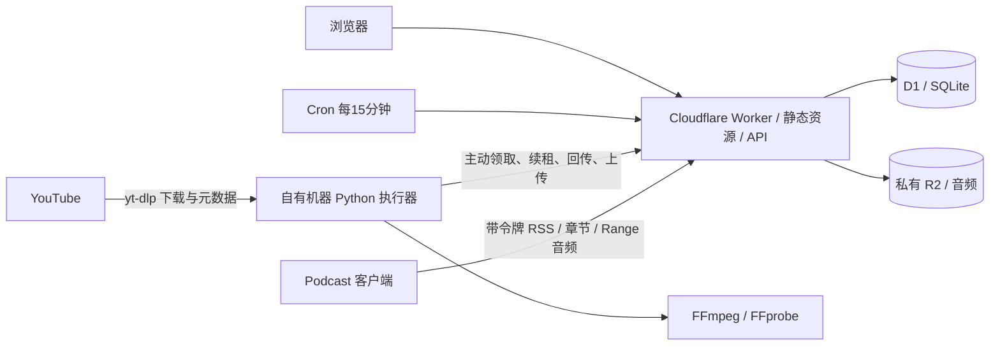

# YouTast 开发交接

更新时间：2026-10-23（Asia/Shanghai）。本文是当前源码、发布和待办的交接入口；历史验证按原日期与环境标注，不把旧部署、旧进程或旧测试数量当成当前事实。

文档导航：[开发与测试](DEVELOPMENT.md) · [版本与发布](RELEASING.md) · [分页修复验证](PAGINATION-VERIFICATION.md) · [列表与搜索验证](COLLECTIONS-VERIFICATION.md) · [账号安全](ACCOUNT-SECURITY.md) · [运维与备份](OPERATIONS.md) · [变更记录](../CHANGELOG.md)。

## 1. 状态口径与当前交付

- **已实现**：当前源码中有对应实现，不等同于所有环境均验证通过。
- **已验证**：列明验证环境、范围和证据；模拟上游、真实 FFmpeg、真实 YouTube、实体播放器分别说明。
- **仅计划 / 待实现**：没有可交付实现，不应向用户宣称已经完成。
- 运行状态是查询时点的快照。2026-10-23 23:17 的只读健康检查返回 healthy、activeJobs=0，rate/window/audio/replay 均为1，最近一次轮询距查询157秒（阈值400秒）。这仅证明该凭证、API/数据库通路及最近轮询，不代表YouTube、R2播放或主机全部进程正常，不保存历史PID作为未来健康证明。

线上实例：<https://youtast.yi-yi.workers.dev/>；本地常用地址：<http://127.0.0.1:8787/>。

最近交付：

| 交付 | 状态与验证 | 生产版本 |
| --- | --- | --- |
| 账号改密与恢复 | 已实现、已部署；本地API/UI、确定性登录竞态及生产临时普通账号验证通过；操作员CLI远程恢复及精确清理通过 | `b91c8543-65cc-4bb6-b440-469707f2c5ea` |
| 运维工具与旧专项清理 | 只读健康6项测试、本地D1/R2备份恢复演练与7项旧API专项通过；生产全量备份/恢复及告警未执行 | 本机工具，无Worker变更 |
| 全局分页、搜索与测试清理 | 已实现、已部署；本地152条节目/82项任务、浏览器及线上临时频道分页/搜索通过；六项专项确认精确清理；详见列表验证记录 | `a62b2e26-1079-48e1-a471-5e3bb661a9af` |
| 频道详情分页及删除退页修复 | 已实现、已部署；16 项 JS 单元、独立本地 API/浏览器、线上临时频道 32 条分页与缓存 31→30→0 删除验证通过；详见分页验证记录 | `781c0c3f-8b37-49da-89f6-c604e43857ae` |
| 频道详情页 | 已实现、已部署；本地独立分页/排序/权限测试、浏览器交互、线上四类详情接口与资源检查通过 | `837f86e6-11b7-4a95-b6ff-0152d5e66d99` |
| 设置入口精简 | 已实现、已部署；移除主导航“用户设置”，底部头像和用户名按钮进入 `#settings`；本地 Enter 键进入及线上 HTML 检查通过 | `380430cc-818e-4805-a65e-a94afb366259` |

版本基线：原未提交功能已保存为 `f347713`，分页修复为 `d73b9ef`，最近一次已核验发布源码为 `d807ba4`（账号安全，包含此前列表与搜索）。包版本与执行器 ZIP 文件名仍为 `0.1.0`，不等同 Cloudflare Version ID；当前未建立新版本标签。

全局列表与账号安全已合并推送main并部署；随后运维工具与旧专项清理经 `codex/ops-reliability` 整理并合并main，不涉及Worker或执行器变更。交付状态见对应验证记录。接手仍先执行 `git status --short`，不要重置或覆盖未提交内容。

## 2. 项目架构与技术栈



| 层 | 实际实现 |
| --- | --- |
| 前端 | 原生 HTML/CSS、JavaScript ES Modules，无 React/Vue；hash 路由；本地生成二维码 |
| 服务端 | JavaScript Cloudflare Worker，静态资源 binding `ASSETS`，业务入口 `src/worker.js` |
| 数据库 | D1（SQLite）；账号、会话、来源、节目、任务租约、配额、GC、邀请码、统计等 |
| 对象存储 | 私有 R2，binding `AUDIO`；不公开 bucket，不使用 YouTube 临时播放 URL 作 enclosure |
| 任务调度 | D1 原子任务领取与租约；没有引入 Cloudflare Queues 或 Redis |
| 执行器 | Python 3.11+，`yt-dlp[default]>=2026.10.21`，FFmpeg/FFprobe，Node.js 22+ 或 Deno 供挑战脚本使用 |
| 可选 YouTube 支持 | 本机 YouTube Netscape cookies；bgutil PO Token provider 2.0.2，本机脚本模式 |
| 开发/发布 | Node.js、npm、Wrangler 4（锁文件约束具体安装版本）；esbuild 用于二维码资源打包 |
| 部署方式 | Cloudflare 网页/API/D1/R2；当前一台 Windows 后台执行器，另有 Docker 配置但未实机验证 |

配置文件实际是被 Git 忽略的 `wrangler.jsonc`，不是 `wrangler.toml`。发布模板是 `wrangler.example.jsonc`。已有生产记录到 `0015`；本轮列表、搜索与测试清理无需新增迁移。

执行器从外网主动轮询，不需要给 Windows 或其他节点开放入站端口。一个执行器进程一次处理一个任务；用户并发上限约束同一账号的全部执行器，单进程不会因并发值增大而自动启动多个任务。

## 3. 已实现功能与验证边界

| 功能 | 代码行为 | 已有验证 / 未覆盖范围 |
| --- | --- | --- |
| 账号与隐私 | 邀请注册、用户名密码、7天会话、多用户隔离；账号停用、会话撤销；本轮增加自助改密、管理员协助恢复和操作员CLI恢复 | 本地验证改密/重置、会话与登录竞态、限流和审计脱敏；仍没有邮箱自助找回/2FA，详见账号安全说明 |
| 管理后台 | 独立 admin 角色；用户创建/角色/停用/强制退出、全站及用户存储和月音频流量限额、审计、统计 | 本地及线上管理员 API、浏览器已有验证；不是 Cloudflare 实际账单监控 |
| 邀请码管理 | 新建、使用计数、总次数（0不限）、到期、备注、启停；完整码仅生成时返回 | 并发使用/限额及管理页面有测试与线上记录；旧邀请口令兼容导入 |
| 频道与来源 | 多频道；混合单视频、playlist、作者 `/videos`、作者 `/streams`；规范化去重；删除来源保留已有节目 | 来源与缓存复用 API 测试通过；不承诺自动补齐来源全部历史 |
| 最新 N 与混排 | **每个 Podcast 频道内**合并所有来源，按发布时间取最新 N；N=0关闭；自动排序在 N>0 时跨来源按新到旧排列 | SQL 窗口、混合来源、并发清理及排序回归通过；每个来源仍要扫描有限候选才能合并比较 |
| 去重与缓存 | 同频道按视频 ID；同用户跨频道按音频 profile 复用；有效转码租约互斥；不同用户不共享缓存 | 来源复用、并发与共享对象删除测试通过；文字语言不拆分音频缓存 |
| 下载与音频 | 默认优先原始 AAC，封装 M4A；必要时 AAC-LC 转码；可选强制 AAC 或 MP3；旧 MP3 保留 | 真实 YouTube AAC 包一致、私有 R2/RSS/HEAD/Range/完整解码通过，见第7节 |
| RSS 与订阅 | 私人 feed、令牌轮换、音频 Range、二维码及同源订阅选择页，Apple/Overcast/Pocket Casts/其他 RSS | API、二维码解码、生产匿名页检查通过；实体 iPhone 摄像头/客户端唤起仍待用户实测 |
| 节目信息与章节 | 标题/简介/作者/封面/日期/时长/原视频链接；网页章节跳转、RSS JSON 章节、M4A原生章节/MP3 ID3v2.3 | 网页跳转与 FFmpeg 原生章节检查通过；实体 Apple Podcasts 章节体验未完成开发侧验证 |
| 用户默认与频道覆盖 | 保留时间、文字语言、码率、音频模式、候选数量、最新 N、同步间隔、RSS集数、排序；清理策略仅用户级 | 设置/继承/元数据补取测试通过；设置已改为底部个人按钮进入 |
| 容量与清理 | 原子预留、共享对象唯一计量、GC重试；过期清理；用户可选空间不足自动清理 | 配额并发、孤立对象、引用保护、清理锁测试通过；默认永久保存且自动清理关闭 |
| 请求节奏 | 服务端统一并发与任务启动间隔，执行器执行请求/下载等待；验证失败冷却，暂停/恢复 | API与执行器回归通过；执行器页面控制面板默认折叠；不保证 YouTube 永不限制 |
| 直播回放 | 作者 streams 订阅；跳过实时/预告/处理中；单视频等待回放按间隔重查，defer不消耗错误重试 | 生命周期由离线 fixture 验证；真实 `@Google/streams` 读到3条有限时长回放；未实测等待一场真实直播结束的全过程 |
| 频道详情与搜索 | 频道概览、节目/来源/任务/旧缓存分类；节目和任务每页30条；标题/作者/简介/视频ID搜索；任务按节目名称搜索 | 原分页与删除退页已部署；本轮本地验证搜索后分页、无匹配空态、搜索不改变缺日期作者排序；实体设备仍待验收 |
| 全局列表 | 网页使用独立节目/任务接口，每页30条，支持搜索与深链接；旧dashboard仍只返回100条节目/80条任务用于兼容 | 本地152条节目/82项任务遍历、越界、跨用户隔离通过；浏览器验证超过旧截断位置的弹窗、刷新、前进/后退与390px视口 |
| Windows 后台执行器 | 用户登录启动计划任务、隐藏进程、续租、日志、密钥撤销与空闲升级 | 一台物理Windows真实链路、两执行器离线进程测试通过；第二台物理机器未部署 |

“旧音频缓存”指退出最新 N 窗口但对象仍存在的节目，不是备份或回收站。增大 N 后可以重新进入 RSS；手动删除或自动清理后的音频需重新生成。

## 4. 主要技术决策及原因

### Cloudflare 保存控制面，自有机器处理媒体

下载和转码耗时长且依赖 YouTube 会话、JS runtime 与 FFmpeg，放在自有节点；Worker 只处理账号、调度、上传和读取，减少平台 CPU 压力。D1 租约避免额外队列服务，降低部署复杂度。免费额度依赖账号其他用量，不能保证绝不计费；本文不重新声明或核验平台价格。

### 原始 AAC 优先，M4A 作为播客文件

`audio_mode=source` 优先语言/默认音轨，再选 AAC；原 AAC 文件不超过88,000,000字节时 `-c:a copy`，写章节并 `+faststart`。没有合适 AAC 或过大则按码率编码 AAC-LC。避免无谓有损二次编码，又使输出适合播客播放器。不会直接把易过期、需要 YouTube 请求条件的 URL 放进 RSS。

免转码保留原采样率、声道和响度，不强制音量归一；**文件不一定比64kbps MP3更小**。`compact` 始终编码 AAC；`mp3` 保留兼容选项。AAC 转码档位：48kbps→24kHz单声道；64/96kbps→48kHz单声道；128kbps→48kHz最多双声道，源单声道不升为双声道。码率变更不批量重做旧音频。

### 选择最新节目与展示排序分开

`active_episode_window` 先按频道所有已发现候选的发布时间选 N；再按频道展示排序输出。默认 `source` 在最新 N 开启时变为跨来源新到旧，关闭时按来源分组；手动 `source_grouped` 保留分组。playlist 按位置，作者组默认从早到晚，单视频按加入次序；统一排序缺日期排末尾，作者组缺日期则整个组按列表位置反排，避免不稳定比较。下载完成时间不参与排序。

保留旧缓存减少重复计算；只有保留期、手动删除或用户允许的空间清理会移除对象。默认不因功能升级自动删除用户数据。

### 文字语言不控制音轨

优先使用 YouTube 已提供的对应语言标题/简介，没有就保留原文；没有外部翻译模型。已有音频可只更新元数据，无需因语言变化重转。字幕/歌词不是这项设置的实现范围。

### 隐私边界与令牌

会话 Cookie 为 HttpOnly / SameSite=Strict，HTTPS 下 Secure；会话7天。密码 PBKDF2-SHA256，独立 salt，100,000次；会话和执行器 token 保存摘要。非执行器写 API 校验同源 Origin；执行器使用独立 Bearer 凭证和租约令牌。

RSS、媒体、章节和订阅页使用频道随机令牌，不要求播放器进行网页登录；持有链接即可访问。轮换后旧链接失效，但不能撤回播放器已下载文件。R2私有并不意味着端到端加密：Cloudflare 管理员与执行器管理员仍可访问其负责的数据。

YouTube cookies 仅留执行器机器，验证 Netscape格式及 YouTube域名，每次使用临时副本，不上传 Cloudflare，不记录原始敏感报错。PO Token 组件是可选本地依赖；它不保证所有视频可获取，也不实现付费/会员授权绕过。

### 请求控制放在服务端和执行器，网页仅编辑策略

服务端跨机器控制用户并发与任务启动；执行器按返回策略设置 yt-dlp 等待及片段并发。避免多个浏览器或机器各自计时而越过总限制。暂停允许正在处理的工作完成；更新执行器优先等待空闲，避免中断有效租约。

## 5. 默认值、限制与调度

| 设置 | 默认 / 可选范围（以源码校验为准） |
| --- | --- |
| 保留时间 | 0永久；0–3650天 |
| 文字语言 | zh-CN；original/zh-CN/zh-TW/en/ja/ko/es/fr/de |
| 音频模式、码率 | source；source/compact/mp3；48/64/96/128kbps，默认64 |
| 来源候选数 | 30；1–100，自由整数 |
| 频道合并最新N | 0关闭；0–100，自由整数 |
| 同步间隔 | 6小时；1–168小时 |
| RSS集数 | 500；1–1000 |
| 自动空间清理 | off；可选 oldest（用户级） |
| 请求控制 | 并发1（1–3）、启动间隔60s（0–3600）、请求间隔2s（0–30）、下载基础等待10s（0–60）、冷却1800s（60–86400） |
| 平台应用容量 | 配置默认全站8GB、用户2GB、单集90MB；后台可覆盖部分限额 |
| 其他限制 | 默认最多20频道/用户、30来源/频道、10执行器/用户；执行器时长最多3小时，且按码率/目标体积再限制；源文件最大250,000,000字节 |

非零下载等待还加入最多10秒随机区间。空闲轮询约1分钟逐步退避到5分钟并抖动。租约10分钟，每分钟续租；一般失败最多3次尝试，回放未就绪走延迟路径不消耗次数。

Cron每15分钟检查到期来源、租约及对象清理；并非直播结束或到期那一秒立即处理。本地 dev 不会自然执行线上 Cron，可使用 scheduled 测试入口。单视频已成功发现后无需常规反复扫描；空单视频等待回放则按频道间隔复查。

月流量是应用媒体响应声明字节的计量，不含网页/API/RSS/YouTube下载，不等同实际账单。Range按范围计数、HEAD为0、重复请求重复计入；连接中断可能仍计声明长度，R2读取失败回退统计。按UTC自然月限制，明细保留13个月。

## 6. 重要文件、数据与接口

### 文件导航

| 文件 | 职责 |
| --- | --- |
| `src/worker.js` | 请求路由、认证、频道/来源、任务领取/回传、RSS/媒体、Cron；当前主要业务集成点 |
| `src/lib.js` | 密码与摘要、ID、错误、YouTube规范化、RSS等基础工具 |
| `src/admin.js` / `src/invitations.js` | 管理权限、账号/配额、邀请码及使用计数 |
| `src/passwords.js` / `scripts/recover-account.mjs` | 验证当前密码后更改/管理员重置；操作员私密pending计划与中断恢复 |
| `src/preferences.js` / `src/sorting.js` | 设置校验/元数据清洗、音频profile、JS与SQL排序 |
| `src/execution.js` | 用户执行策略默认/校验/读取 |
| `src/episode-window.js` / `src/scan-records.js` | 最新窗口任务调节与扫描记录处理 |
| `src/storage-policy.js` / `src/audio.js` | 自动空间清理、音频扩展名与MIME处理 |
| `src/channel-detail.js` / `src/listing.js` | 归属校验后的频道详情；列表分页、参数校验、搜索和用户隔离 |
| `public/index.html` / `public/app.js` / `public/style.css` | 工作台、hash路由、登录/弹窗、底部设置入口与布局 |
| `public/channel-detail.js` / `public/list-ui.js` | 详情与全局列表纯渲染器；搜索与分页链接；弹窗优先取当前详情/全局分页结果 |
| `tests/local-fixture.mjs` | 仅本地 D1 fixture 与本轮注册账号的 ID+用户名清理；不按前缀批量删除 |
| `public/admin-ui.js` / `public/execution-ui.js` | 管理后台、默认折叠的请求控制面板 |
| `public/subscribe-*.js` / `src/subscribe.js` | 客户端链接、私有订阅选择页、本地二维码 |
| `executor/agent.py` | 下载/转码/元数据、cookies隔离、回放状态、租约与回传 |
| `scripts/windows-runner.py` / `scripts/windows-executor.ps1` | Windows环境加载、后台进程及登录启动任务 |
| `scripts/restart-windows-when-idle.py` | 空闲升级；注意保存并恢复原暂停状态 |
| `scripts/package-executor.py` | 7个文件允许列表打包，不包含密钥/cookies |
| `scripts/probe-executor-http.py` / `scripts/check-windows-executor.mjs` | 无领取副作用的status诊断 |
| `migrations/0001_*.sql`–`0015_*.sql` | 全部数据库变更；按顺序应用，勿手工跳过旧迁移 |

关键数据包括 `users`、`sessions`、`channels`、`sources`、`episodes`、`jobs`、`executors`、`object_gc`、`execution_policy`、`storage_cleanup_locks`、`invitations`、`usage_daily`、`app_config`、`admin_audit`。关键视图 `channel_preferences` 合并频道与用户默认，`active_episode_window` 提供最新 N 选择。部分保障由SQL索引/触发器实现，改业务时要一起阅读迁移。

迁移分组：0001–0004基础/对象回收/复用；0005–0006排序及加入位置；0007–0009偏好/元数据/协议/文字语言；0010后台；0011邀请码；0012请求控制；0013最新窗口与空间清理；0014AAC；0015直播回放。新客户端能力通过协议及 rate/window/audio/replay 标志门禁保护。

### 接口索引

除下表明确的令牌路径外，网页API需要登录；写请求带同源 Origin。字段以实现为准，本表不是完整 OpenAPI。

| 方法 / 路径 | 用途 |
| --- | --- |
| POST `/api/auth/register`、`/api/auth/login`、`/api/auth/logout` | 注册/登录/注销 |
| POST `/api/auth/password`；POST `/api/admin/users/:id/password` | 自助改密；管理员重新验证自己的密码后恢复其他账号；均撤销目标全部网页登录会话 |
| GET `/api/me`、`/api/dashboard` | 当前用户及兼容工作台摘要；摘要仍限节目100条/任务80条，网页完整列表使用下列独立接口 |
| GET `/api/episodes?offset=0&q=`、`/api/jobs?offset=0&q=` | 当前用户完整列表，每页30条；q最多200字符；节目搜标题/视频ID/作者/简介，任务搜节目/频道名称；越界归末页、空列表归零 |
| GET/POST `/api/settings` | 用户默认，GET返回options/ranges |
| POST `/api/channels`；DELETE `/api/channels/:id` | 创建/删除本人频道 |
| GET `/api/channels/:id/detail?tab=episodes&offset=0` | tab为episodes/sources/jobs/archive；节目/任务每页30条，可加q搜索；本人频道，其他用户404；offset非负整数≤1,000,000，越界归末页 |
| POST `/api/channels/:id/settings`、`/sort`、`/rotate`、`/sync` | 频道偏好、排序、轮换私人令牌、调度同步 |
| POST `/api/channels/:id/sources` | urls数组，可选include_replays；作者展开普通/直播两个来源，均计数 |
| DELETE `/api/channels/:id/sources/:sourceId` | 删除来源；停止后续扫描，不删除既有节目 |
| POST `/api/jobs/:id/retry`、`/api/episodes/:id/retry`；DELETE `/api/episodes/:id` | 任务重试、重新生成、删除音频 |
| POST `/api/executors`；DELETE `/api/executors/:id` | 创建/撤销用户执行器凭证 |
| GET/POST `/api/execution-policy`；POST `/api/execution-policy/resume` | 请求控制、解除暂停/冷却 |
| POST `/api/executor/status`、`/api/executor/claim` | Bearer鉴权；status不领取任务，claim有调度副作用 |
| POST `/api/executor/jobs/:id/{heartbeat,scan,audio,fail,metadata}` | Bearer + `x-lease-token`；上传音频为二进制，其他按对应协议；拒绝失效租约 |
| GET `/api/admin/overview`、`/api/admin/users` | 管理员统计、分页用户查询 |
| POST `/api/admin/config`、`/api/admin/users`、`/api/admin/users/:id`、`/api/admin/users/:id/logout` | 站点配置、用户创建/修改/退出 |
| GET/POST `/api/admin/invitations`；POST `/api/admin/invitations/:id` | 邀请码管理 |
| GET/HEAD `/feed/:token.xml` | 仅可用窗口内且有音频对象的节目；按设置排序 |
| GET/HEAD `/media/:token/:episodeId.m4a`（或.mp3） | 私有媒体、Range；实际对象决定MIME |
| GET/HEAD `/chapters/:token/:episodeId.json` | 私有Podcasting 2.0章节 |
| GET `/subscribe/:token` | 同源订阅选择页，令牌仍属访问凭证 |

前端路由：`#channels`、`#episodes/:offset`、`#jobs/:offset`、`#executors`、`#settings`、`#admin`；全局列表 offset 可省略。详情为 `#channel/:id/:tab/:offset`，后两段可省略。全局/详情分页可附 `?q=编码后的关键词`；翻页保留搜索，新的搜索归第一页，越界纠正用 replaceState 不追加历史。详情hash只含频道ID，不含订阅令牌。底部 `.user-profile[data-view="settings"]` 使用已有导航处理，退出按钮独立。

## 7. 验证证据与复验方式

### 本轮新增验证

- 列表交付语法检查与19项JS单元通过；账号安全交付新增确定性旧登录竞态测试，当前20项JS通过。Python离线32项已重新通过，没有请求YouTube。
- `tests/collections.mjs`：152条节目、82项任务完整分页，搜索后35条分页、中文/字面通配符、越界、400/401/404及跨用户隔离通过；搜索排除缺日期行后仍保留作者组原排序。
- `tests/channel_detail.mjs`、`channel_sort.mjs`、`preferences_metadata.mjs`、`audio_formats.mjs`、`live_replays.mjs`、`execution_policy.mjs`本地通过；六项专项精确清理本轮注册账号，清理后SQL确认不存在。详情测试主动抛错并带 --keep 时同样不保留账号。
- 浏览器125条节目/85项任务：全局越界到121–125/61–85条；超过旧100条摘要的节目弹窗、搜索35条的末页、刷新、前进/后退、清除搜索、频道搜索零匹配和390×844视口无横向溢出通过。
- 账号改密/管理员恢复API与浏览器、一次性D1操作员恢复演练通过，完整integration本地流程通过并新增精确账号清理；见 [ACCOUNT-SECURITY.md](ACCOUNT-SECURITY.md)。
- 原始产物仅在被忽略的test-results，脱敏摘要与复验步骤见 [COLLECTIONS-VERIFICATION.md](COLLECTIONS-VERIFICATION.md)。

### 较早交付结果（历史证据，不代表本轮重跑）

- 最近详情交付：`npm run check`通过；`npm test`的14项JS单元通过；`node tests/channel_sort.mjs`通过；`node tests/channel_detail.mjs --keep`验证32条分页、全局100条截断不影响详情、窗口/缓存分离、参数400、匿名401和跨用户404。生成的两个本地测试频道已清理。
- 详情浏览器：卡片进入、分页第二页、全局列表以外的节目弹窗、刷新深链接、分类交互已检查；没有单独完成实体移动端详情验收。
- 生产详情：四类空频道接口、发布JS/CSS检查通过，临时线上频道删除。`test-results/channel-detail-production.json`、`channel-detail-ui.png`。
- 设置入口：本地键盘Enter进入 `#settings` 并显示设置表单；生产新HTML确认旧nav移除、新profile按钮存在。`test-results/profile-settings-entry.png`。首次无缓存参数请求拿到旧页面，随后带验证参数/禁缓存检查拿到新资源，不应把首个断言失败解释成业务接口故障。
- AAC真实链路：`jNQXAC9IVRw`生成约19秒M4A、309870字节、约128kbps；源AAC和封装输出ADTS包哈希一致；R2下载与本地输出一致，RSS/HEAD/206 Range/FFmpeg完整解码通过。`test-results/aac-production.json`；临时验证频道与执行器已清理。
- 曾受验证限制的视频 `eH0yNDJJ74s`：本机cookies+PO Token下载成功，后续生产任务done；独立RSS读取约1345秒、10756268字节旧MP3，HEAD/Range及完整解码通过。`test-results/long-rss-verification.json`。这不能证明cookies长期有效或所有视频可用。
- 直播：`tests/live_replays.mjs`、直播专用8项Python、当时已有24项Python与14项JS通过；真实YouTube只验证streams元数据扫描，没有等待真实直播结束。`test-results/live-replay-upstream.json`。
- 两个真实Python执行器进程的扫描/转换/上传测试使用离线YouTube fixture和真实FFmpeg，不能描述为两台物理机器或全部真实上游。

上述 `test-results/`、`.wrangler/`、`DEPLOYMENT.md`、`VERIFICATION.md` 均被 Git 忽略，换机器或新克隆可能没有；本文保留结论和限制，但不复制私密验证输入。旧运维文档是时间线，不应把早期失败或当时PID当成当前状态。

### 常用命令

```powershell
npm ci
npm run check
npm test
# 先配置本地 .dev.vars 并应用本地迁移，再在另一终端启动：
npm run db:local
npm run dev
# 有合适的独立本地测试环境时再运行：
node tests/channel_sort.mjs
node tests/channel_detail.mjs
```

测试脚本对本地数据有写入：`channel_detail.mjs`使用专用本地邀请值、注册临时用户、插入SQLite fixture；后续已移除清空 `login_limits`，并支持配对的 `TEST_ORIGIN` / `TEST_PERSIST_TO`。不要把生产origin硬替换进去运行；建议独立本地状态/测试环境。`--keep`会在被忽略的结果文件保存临时测试凭证，测试完要清理。本轮迁移的API专项均按注册返回的ID+用户名精确清理普通账号；admin保留一个明确的本地fixture管理员，invitations保留浏览器用邀请记录。Python真实上游/多进程脚本需另行阅读其清理范围。

其他专项见 `tests/admin.mjs`、`invitations.mjs`、`execution_policy.mjs`、`latest_cleanup.mjs`、`audio_formats.mjs`、`live_replays.mjs`、`preferences_metadata.mjs`、`storage_recovery.mjs`及 `tests/executor_*.py`；各脚本对端口、邀请码、fixture的要求需先读文件，不能假设一条命令包含全部专项。

真实上游复验脚本：`scripts/verify-aac-production.py`、`scripts/verify-live-replay-scan.py`、`scripts/verify-rss-audio.py`。前者会创建临时线上频道/执行器并请求真实YouTube，应先理解账号归属、限额及清理逻辑；status探测适合无副作用健康检查。

## 8. 当前问题、已知 Bug 与限制

### 可从当前代码确认的问题

1. **详情越界分页（后续已修复、已部署）**：接口在同一批查询内取最后有效页，空列表 offset 归零；前端用 replaceState 同步地址。补充空页恢复入口，并修复音频删除受 GC 触发器变更计数影响而误报 409 的关联问题。独立本地 API、浏览器与生产临时频道复验通过；范围与复验步骤见 [PAGINATION-VERIFICATION.md](PAGINATION-VERIFICATION.md)。
2. **全局截断与详情搜索（本轮已实现）**：网页转用完整分页接口，支持全局和频道内搜索；兼容dashboard保留原摘要上限。搜索是字面子串匹配，ASCII大小写不敏感，不提供拼音、分词或相关度排序；数值范围与用户隔离均由服务端校验。
3. **文档陈旧描述（README 已修正）**：后续文档整理已修正 README 的预设数字、作者直播、默认排序与设置入口。被忽略的 DEPLOYMENT 历史段仍按原时间线保留，不能作为当前操作说明。
4. **测试残留（API专项已分批修复）**：原六项与列表、integration、passwords，以及后续admin、invitations、latest_cleanup、job_recovery、sources_reuse、storage_recovery、quota均使用注册返回的ID+用户名清理普通账号；保留可复用管理员与邀请UI记录。admin不再批量降级其他管理员，运行前要求隔离状态，并还原原始全站配置；不再清空login_limits。Python真实上游/多进程专项不在本轮清理迁移范围。

### 环境故障与待验证项（不等同确定的代码 Bug）

- YouTube会因会话、IP、上游变更等返回验证或403；cookies、mweb和PO Token是当前成功配置，不能保证持续可用。先确认浏览器与执行器网络一致、版本与会话状态，再谨慎重试，勿循环高频请求。
- 曾遇Cloudflare HTTP429 / Error1027 HTML，前端已转换友好错误并停止自动刷新，执行器等待UTC零点重置。它与YouTube403、密码错误无关。账号总请求来源仍需控制台核验。
- Windows Node直接fetch有过连接超时；Python显式代理探测可成功。部署CLI常需当前终端设置HTTPS_PROXY；不要因一次超时直接重新建资源或重置凭证。
- Cloudflare迁移曾短暂7403，验证授权仍有效后重试成功；不必一见7403就让用户重登。
- Apple客户端可能重排RSS，不保证完全尊重feed顺序；简介时间戳可点击与否不能由内嵌章节测试替代。已下载旧媒体通常需移除下载后重新下载才能获取章节更新。
- 实体iPhone/iPad播放、章节列表、扫码唤起，真实直播结束后的持续轮询全链路、Docker构建、多物理机器协作、长期运行及大规模负载尚缺完整验收。
- 本轮按变更执行语法、20项JS、健康6项、备份恢复及相关API专项；没有把它描述为所有上游/实体设备的全套验收。执行器源码未变更，无需为这些改动重启下载任务。

## 9. 未完成任务与仅计划功能

| 项目 | 当前状态 / 用户约束 |
| --- | --- |
| 字幕/歌词同步文本 | 用户提出过；**未实现**字幕抓取、字幕存储、定时文本/转录RSS输出。不能把简介或章节称为同步文本，也不能保证Apple私有RSS原生显示 |
| 第二台执行器 | **用户明确暂缓**；不应反复索要SSH信息，待用户主动恢复此任务 |
| 实体播放器验收 | 待用户或具备设备的测试者执行并记录；优先iPhone/iPad |
| 账号恢复与安全扩展 | 自助改密、管理员协助与操作员CLI恢复已实现，并通过本地及生产临时账号验证，见 [ACCOUNT-SECURITY.md](ACCOUNT-SECURITY.md)；邮箱验证/邮件自助找回、2FA、自助账号删除仍未实现 |
| 监控与备份恢复 | 增加只读健康诊断、D1与引用R2备份及隔离本地恢复；本地演练通过，生产仅验证D1导出兼容；完整生产备份/恢复、告警与账单联动仍未验证，见运维说明 |
| 全局分页、详情搜索 | 用户本轮确认推进可执行待办，已实现并完成本地验证；交付范围见列表验证记录 |
| 实时录制直播、音频裁剪、AI摘要/配音/转写 | 没有实现；用户选的是直播结束后收录，时间选择已澄清为保留章节，不要扩大成实时录音或裁剪任务 |

## 10. 运维入口与下一步建议

私密配置仅在本机 `.secrets/` 和 `.dev.vars`：管理员凭证、Windows执行器token、YouTube cookies、PO Token路径、私人订阅信息。只在本机读取必要字段，禁止把文件全文、Bearer、cookies或完整feed URL写进文档/日志/聊天。`wrangler.jsonc`也属于本机部署配置，不直接提交。

Windows已有配置时后台启动：

```powershell
powershell -ExecutionPolicy Bypass -File scripts/windows-executor.ps1
python scripts/probe-executor-http.py
```

启动脚本优先注册当前用户登录触发任务；失败则隐藏进程运行。运行状态在 `.wrangler/windows-executor/`，勿用历史PID强杀进程。升级先查看有效租约和暂停状态，等待空闲，再更换进程并恢复原策略。最近直播交付记录中的Windows执行器已回报rate/window/audio/replay能力；当前健康应使用status重新确认。

发布流程：

```powershell
npm run check
npm test
# 只有新增迁移时需要；先确认目标为正确生产资源：
npm run db:remote
# 本机CLI如需代理，按实际网络设置当前进程的HTTPS_PROXY
npm run deploy
```

`deploy`会构建本地二维码资源、生成执行器允许列表ZIP、发布Worker与静态资源；记录实际Version ID后验证关键API和资源。最近一次已核验部署的执行器ZIP SHA-256为 `f81552e558d2793395fef5f3959297318f2d12da89a1330d2f589b442d01e44b`。打包使用源文件时间戳，重新打包后应记录当次校验值，不能假定静态发布会保留旧ZIP字节。不要盲目运行 bootstrap、重新创建数据库/bucket或轮换已有凭证。

后续工作按前置条件区分，不把长期建议当作已经完成：

| 顺序 / 状态 | 工作与验收条件 |
| --- | --- |
| 已交付 | 全局分页/搜索与六项测试清理：代码检查、本地API/浏览器和生产临时频道复验通过，已提交、推送、部署，临时频道清理确认 |
| 已交付 | 其余7项旧API专项按精确身份清理；admin/invitation保留明确fixture，配置还原与不清空限流表已验证 |
| 已交付 | 账号更改密码、管理员协助与操作员恢复：本地API/UI、一次性D1及生产临时普通账号验证通过，未修改真实用户凭据 |
| 已实现，生产演练需维护条件 | 健康诊断与本地D1/R2恢复演练通过；生产完整备份需全站静止和容量预算，生产恢复仍需单独方案，见运维说明 |
| 需要设备/时间 | iPhone/iPad播放、章节、私人RSS与扫码唤起；真实直播结束后的长周期链路，保持正常同步节奏，不能以离线fixture代替 |
| 需要产品决定 | 字幕/同步文本的目标客户端与呈现方式，尚未承诺Apple私有RSS原生能力；2FA/邮件恢复等先明确交互与外部服务 |
| 用户暂缓 | 第二台物理机器部署；等待用户重新提出，不索要SSH信息 |

维护本文时先区分源码实现、已执行的验证与仍需条件的事项。仅文档变化可提交后不部署；业务变化应验证再发布。已经完成的条目移入交付与证据区，保留历史来源而不继续列作当前Bug。
